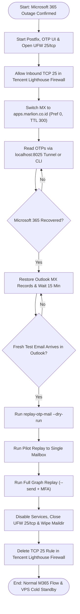

# Email Outage Disaster Recovery Runbook (`marlion.co.id` & `manorian.co.id`)

Emergency failover procedure to temporarily capture inbound emails (OTPs and operational mail) on the Tencent Cloud Lighthouse VPS (`43.134.92.151`) during a Microsoft 365 / Exchange Online outage, replay all captured emails back into Exchange Online once services recover, and return the VPS to silent **Cold Standby**.



---

## Infrastructure Inventory (Pre-Configured on `43.134.92.151`)

| Component | Location / Value | Purpose |
| :--- | :--- | :--- |
| **VPS Host** | `ubuntu@43.134.92.151` (SSH key: `%USERPROFILE%\.ssh\tencent_lighthouse`) | Tencent Cloud Lighthouse (Ubuntu 24.04 + CloudPanel v2) |
| **MX Target Hostname** | `apps.marlion.co.id` (`43.134.92.151`, Cloudflare **DNS only / gray cloud**) | Valid A record + CloudPanel auto-renewed TLS cert |
| **Postfix Config** | `/etc/postfix/main.cf`, `/etc/postfix/virtual` | Receive-only (`default_transport = error:...`, catch-all `@marlion.co.id` & `@manorian.co.id` → `otpmail@localhost`) |
| **Maildir Storage** | `/home/otpmail/Maildir/{new,cur,tmp}` | Isolated non-login user `otpmail` |
| **CLI OTP Reader** | `/usr/local/bin/read-otp-mail` | Prints recent emails + detected 4–8 digit OTP codes |
| **Browser OTP UI** | `otp-mail-ui.service` (`/usr/local/bin/otp-mail-ui.py`, `127.0.0.1:8025`) | Private read-only web UI (accessible **only** via SSH tunnel) |
| **Graph Replay Tool** | `/usr/local/bin/replay-otp-mail` | Sends captured `.eml` files back to M365 via Microsoft Graph (`443`) |
| **Entra ID App** | `VPS-Mail-Recovery` (Tenant: `a61c465d-eaa8-406d-aeca-f732d2a826a9`, App: `31dd65fa-71ba-40e2-bf58-934a02894635`) | Single-tenant public client with delegated `Mail.Send` & `Mail.ReadWrite` |

> **DNS Recommendation:** Keep `marlion.co.id` hosted on **Cloudflare** (not `bdm.microsoftonline.com`) and keep MX TTL at `300`–`600` seconds on both Cloudflare (`marlion.co.id`) and Niagahoster (`manorian.co.id`). That allows instant MX failover even if `admin.microsoft.com` is unreachable.

---

## Phase 1: Activate Emergency Inbound Mail (~3 Minutes)

### Step 1.1: Start Mail Services & Open VPS Host Firewall
Run from Windows PowerShell:

```powershell
ssh -i "$env:USERPROFILE\.ssh\tencent_lighthouse" ubuntu@43.134.92.151 "sudo ufw allow 25/tcp comment 'TEMP OTP Postfix' && sudo postfix check && sudo systemctl enable --now postfix otp-mail-ui.service && sudo systemctl reload postfix && sudo ss -tlnp | grep -E ':25|:8025'"
```

Confirm output shows:
- `0.0.0.0:25` (`master` / Postfix)
- `127.0.0.1:8025` (`python3` / `otp-mail-ui.service`) — **never** `0.0.0.0:8025`

*(Note: `systemctl reload postfix` ensures Postfix loads CloudPanel's latest renewed `/etc/nginx/ssl-certificates/apps.marlion.co.id.crt`.)*

### Step 1.2: Open Inbound Port 25 in Tencent Cloud Lighthouse
1. Log in to **Tencent Cloud Console → Lighthouse → `43.134.92.151` → Firewall**.
2. Click **Add Rule**:
   - **Protocol:** `Custom` → `TCP`
   - **Port:** `25`
   - **Source:** `0.0.0.0/0`
   - **Action:** `Allow`
   - **Remark:** `TEMP-OTP-MAIL`

### Step 1.3: Switch MX Records to `apps.marlion.co.id`
Keep all `A`, `CNAME`, and `TXT` (`SPF`, `MS=`, `mscid=`) records untouched. Edit **only MX** on each domain:

| Domain | DNS Panel | New MX Target | Priority | TTL |
| :--- | :--- | :--- | :--- | :--- |
| `marlion.co.id` | Cloudflare (**DNS → Records**) | `apps.marlion.co.id` | `0` | `5 min` (`300`) |
| `manorian.co.id` | Niagahoster (**DNS Zone Editor**) | `apps.marlion.co.id` | `0` | `300` |

> **Important:** Verify `A | apps.marlion.co.id -> 43.134.92.151` in Cloudflare remains **DNS only (gray cloud)**.

### Step 1.4: Verify Propagation & Live Receipt
Run from the VPS (or local PowerShell) to confirm global resolvers see the new MX:

```powershell
ssh -i "$env:USERPROFILE\.ssh\tencent_lighthouse" ubuntu@43.134.92.151 "dig +short @1.1.1.1 marlion.co.id MX; dig +short @1.1.1.1 manorian.co.id MX"
```

Send a test email from a personal Gmail to `gregory.wintery@marlion.co.id` and `admin@manorian.co.id`, then watch `/var/log/mail.log`:

```powershell
ssh -i "$env:USERPROFILE\.ssh\tencent_lighthouse" ubuntu@43.134.92.151 "sudo tail -n 20 /var/log/mail.log"
```

---

## Phase 2: Read Incoming OTPs During the Outage

### Option A: Private Browser Inbox UI (`http://localhost:8025`)
Open a **new Windows PowerShell** window on your local PC (not inside an existing VPS SSH session):

```powershell
ssh -N -L 8025:127.0.0.1:8025 -i "$env:USERPROFILE\.ssh\tencent_lighthouse" ubuntu@43.134.92.151
```

Leave that PowerShell window open and browse to **`http://localhost:8025`**. It auto-refreshes every 15 seconds, highlights detected numeric OTP codes, and renders HTML emails inside a sandboxed `<iframe>`.

### Option B: Quick Terminal CLI
```powershell
ssh -i "$env:USERPROFILE\.ssh\tencent_lighthouse" ubuntu@43.134.92.151 "sudo /usr/local/bin/read-otp-mail 25"
```

---

## Phase 3: Restore Exchange Mail Flow & Replay Captured Emails

> **CRITICAL:** Never run `replay-otp-mail --send` before restoring MX records and waiting for TTL drain, or replayed emails will loop right back into `/home/otpmail/Maildir`.

### Step 3.1: Restore Original Outlook MX Records
| Domain | DNS Panel | Original MX Target | Priority | TTL |
| :--- | :--- | :--- | :--- | :--- |
| `marlion.co.id` | Cloudflare | `marlion-co-id.mail.protection.outlook.com` | `0` | `300`–`600` |
| `manorian.co.id` | Niagahoster | `manorian-co-id.mail.protection.outlook.com` | `0` | `300`–`600` |

### Step 3.2: Wait 10–15 Minutes & Confirm Outlook Receives Fresh Mail
Verify DNS on `1.1.1.1`:

```powershell
ssh -i "$env:USERPROFILE\.ssh\tencent_lighthouse" ubuntu@43.134.92.151 "dig +short @1.1.1.1 marlion.co.id MX; dig +short @1.1.1.1 manorian.co.id MX"
```

Send a fresh test email from a personal Gmail to your M365 mailbox and confirm it appears in **Outlook** (and **not** in `http://localhost:8025`).

### Step 3.3: Dry-Run Preview on Captured Emails
```powershell
ssh -i "$env:USERPROFILE\.ssh\tencent_lighthouse" ubuntu@43.134.92.151 "sudo /usr/local/bin/replay-otp-mail --dry-run"
```

Review the recipient list (`X-Original-To`) and count. Note that messages > `2.5 MB` automatically use `uploadSession` instead of `sendMail`.

### Step 3.4: Single-Mailbox Pilot Replay
```powershell
ssh -t -i "$env:USERPROFILE\.ssh\tencent_lighthouse" ubuntu@43.134.92.151 "sudo /usr/local/bin/replay-otp-mail --send --filter-recipient gregory.wintery@marlion.co.id"
```

1. Open the printed `https://microsoft.com/devicelogin` URL in your browser and enter the device code.
2. Sign in with your M365 account and approve MFA.
3. Verify the `[Recovered] ...` email arrives in your Outlook Inbox with `Reply-To` and `original-message.eml` attached.

### Step 3.5: Full Replay to All Recipients
```powershell
ssh -t -i "$env:USERPROFILE\.ssh\tencent_lighthouse" ubuntu@43.134.92.151 "sudo /usr/local/bin/replay-otp-mail --send"
```

Confirm `Failed: 0`. If interrupted midway, re-running the exact same command skips already-sent messages listed in `/home/otpmail/replayed.log`.

*(Note: If you set `VPS-Mail-Recovery` sign-in to **No** in Enterprise Applications during Cold Standby, toggle **Enabled for users to sign-in = Yes** first before running Step 3.4/3.5. If you deleted the app registration entirely, recreate a single-tenant Public Client app in [entra.microsoft.com](https://entra.microsoft.com) with **Allow public client flows = Yes** and Delegated `Mail.Send` + `Mail.ReadWrite`, then pass `--tenant-id <TENANT_ID> --client-id <CLIENT_ID>`.)*

---

## Phase 4: Return VPS to Cold Standby (Zero Open Ports)

Once replay succeeds and all recipients have received their recovered emails:

### Step 4.1: Disable Mail Services, Close UFW Port 25 & Wipe Captured Maildir
```powershell
ssh -i "$env:USERPROFILE\.ssh\tencent_lighthouse" ubuntu@43.134.92.151 "sudo ufw delete allow 25/tcp && sudo systemctl disable --now postfix otp-mail-ui.service && sudo find /home/otpmail/Maildir/new /home/otpmail/Maildir/cur -type f -delete && sudo rm -f /home/otpmail/replayed.log"
```

### Step 4.2: Remove Cloud Firewall Rule & Disable Entra App Sign-In
1. In **Tencent Cloud Console → Lighthouse → `43.134.92.151` → Firewall**, delete the `TEMP-OTP-MAIL` (`TCP:25`) Allow rule.
2. In **[entra.microsoft.com](https://entra.microsoft.com) → Identity → Applications → Enterprise applications → `VPS-Mail-Recovery` → Properties**, set **Enabled for users to sign-in** to **No** and click **Save** *(preserves your `CLIENT_ID` for future outages while blocking any logins or token issuance while idle)*.

### Step 4.3: Final Cold-Standby Verification
```powershell
# 1. Confirm port 25 and port 8025 are closed on the VPS:
ssh -i "$env:USERPROFILE\.ssh\tencent_lighthouse" ubuntu@43.134.92.151 "sudo ss -tlnp | grep -E ':25|:8025' || echo 'Ports closed cleanly'"

# 2. Confirm external port 25 is unreachable (should return TcpTestSucceeded : False):
Test-NetConnection -ComputerName 43.134.92.151 -Port 25 | Select-Object ComputerName, RemotePort, TcpTestSucceeded

# 3. Confirm production web app health is unaffected:
curl.exe -sS https://apps.marlion.co.id/api/health
```

---

## Troubleshooting

- **`replay-otp-mail --send` aborts with `MX records on 1.1.1.1 do NOT point back to Outlook yet`:** Wait another 5–10 minutes after restoring MX and re-run.
- **Device-code login blocked by Conditional Access:** Temporarily exclude your recovery admin user from any Entra Conditional Access policy blocking Device Code Flow during the 2-minute replay window, then re-enable it afterward.
- **External senders still not reaching VPS during an outage:** Check `sudo tail -n 30 /var/log/mail.log` and confirm both **UFW** (`25/tcp`) and **Tencent Cloud Lighthouse Firewall** (`TCP:25`) are open, and wait up to the previous MX record's old TTL for external senders' DNS caches to refresh.
- **TLS / STARTTLS errors on Postfix startup:** Run `sudo systemctl reload postfix` after confirming `/etc/nginx/ssl-certificates/apps.marlion.co.id.crt` is valid (`sudo openssl x509 -in /etc/nginx/ssl-certificates/apps.marlion.co.id.crt -noout -dates`).
